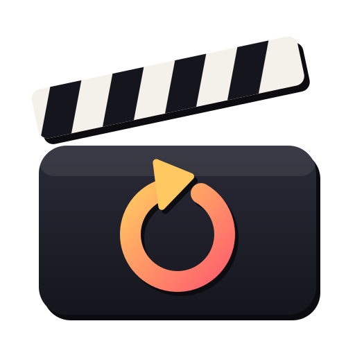

<p align="center">
  
</p>

<h1 align="center">Retake</h1>

<p align="center">
  <strong>Record yourself talking. The retakes are handled for you.</strong><br>
  A voice-following teleprompter, pronunciation coach, recorder and editor for Linux.
</p>

<p align="center">
  <a href="LICENSE"></a>
  
  
</p>

<!-- Demo video goes here -->

<!-- Screenshot: prompter with pronunciation guides -->

---

Recording a talk, a tutorial or a study case alone usually means juggling a prompter, a recorder and an editor, then spending an hour cutting out the stumbles. Retake does all three in one window:

- **The prompter follows your voice.** It scrolls as you read, highlights the next word and never moves while you're silent.
- **Retakes are marked, not cut.** Say *“retake, again”*, press `R`, or just start the sentence over. Retake marks the bad take and keeps recording.
- **Auto edit builds the cut.** When you stop, it proposes an edit that keeps the last good take of every sentence and drops retakes, voice commands and long pauses. Review it in the built-in trim editor, then export.
- **Pronunciation coaching for non-native speakers.** Pronunciation guides above hard words (IPA, English respelling and respelling in your own language), plus a coach that tells you which word to try again and why, and, if you want it strict, makes you drill a missed word until it's right before reading the sentence again.

Everything runs on your machine. Audio never leaves it.

## Contents

- [Features](#features)
- [Install](#install)
- [Quick start](#quick-start)
- [Writing a script](#writing-a-script)
- [Recording](#recording)
- [Voice commands](#voice-commands)
- [Keyboard](#keyboard)
- [Controlling Retake from anywhere](#controlling-retake-from-anywhere)
- [Pronunciation coach](#pronunciation-coach)
- [Editing and exports](#editing-and-exports)
- [Speech engines](#speech-engines)
- [Languages](#languages)
- [Command line](#command-line)
- [Files](#files)
- [Troubleshooting](#troubleshooting)
- [Development](#development)
- [Credits](#credits)

## Features

| | |
|---|---|
| **Projects** | A project is a course or series: import its scripts, record each one over as many days as you like, re-record single sentences from the studio, and export per script. A collapsible explorer (`Ctrl+B`) shows every script with its recordings and exports. |
| **Prompter modes** | Scroll (glides with your voice), step (one line at a time), card (current sentence big, next one below) and page (one paragraph at a time). Mirror mode for teleprompter glass. |
| **Layouts** | **Full** (the prompter with the camera, coach and takes beside it), **Focus** (only the prompter, at full width) and **Lens** (one sentence at a time, for a small window right under the camera). Switch with `Tab`, `1`–`3`, or the Full | Focus | Lens switch in the top bar. The top bar always shows the microphone and the machine's meters. |
| **Recording** | Lossless FLAC of your microphone, always. Optional video from a camera: a webcam (or any video device) or an Android phone's camera over USB. `Space` waits until the video is recording, so the first words always have picture. |
| **Strict scripts** | Speech that isn't in the script is marked, so Auto edit can drop asides between sentences, or even fillers inside them. |
| **Record ⇄ Studio** | A switch in the top bar (`Ctrl+Tab`) goes between recording and editing the open script; a script with nothing recorded yet opens an empty studio. |
| **Studio editor** | The timeline is the script: waveform, filmstrip, takes, markers and transcript, sentence after sentence, whichever recording each one was read in. Each sentence uses its newest take; the side panel lists the others (rejected ones too) to switch to with a click, and each take keeps its own trims. `V` shows each take whole with its cuts greyed, to restore them. The script's sections run along the top as chapters; click one to select its sentences. Split, trim, undo. |
| **Exports** | Video (MP4 with H.264, HEVC or AV1, WebM VP9, MOV ProRes) at any smaller size and frame rate, optionally with burned-in captions; audio (FLAC, WAV, ALAC, MP3, AAC, Opus, Vorbis) with chapters and two-pass loudness normalization; captions (SRT, WebVTT, word-by-word WebVTT, plain transcript); timelines for other editors (OpenTimelineIO, Final Cut Pro 7 XML, CMX 3600 EDL); Audacity labels. |
| **Resource monitor** | Meters in the top bar for CPU, RAM, GPU, VRAM and the microphone; click them for the video encoder, temperatures, disk time left and how far behind each speech engine is, so you know before it hurts. |
| **No privileges** | Runs as your user. No sudo, no daemons. |

<!-- Screenshot: studio editor -->

## Install

### Arch Linux / Omarchy (AUR)

```sh
yay -S retake
```

Optional extras, installed separately:

| Package | Adds |
|---|---|
| `python-pytorch` (or `python-pytorch-cuda`, `python-pytorch-rocm`) | Pronunciation scoring and better speech detection |
| `scrcpy` | Android phone as camera |
| `python-faster-whisper` (AUR) | More accurate voice following on NVIDIA GPUs |
| `piper-tts-bin` (AUR) | A natural reference voice instead of espeak-ng |
| `python-nvidia-ml-py` | NVIDIA GPU monitoring |
| `python-evdev` | Exclusive foot pedal input |

### From source

```sh
git clone https://github.com/sergiojrdotnet/retake
cd retake
bin/dev            # creates .venv, installs dependencies, runs Retake
bin/install        # or build and install it as a pacman package
```

### First run

Voice following needs a speech model. The start page offers it, or from a terminal:

```sh
retake models pull vosk-en-us-small-0.15     # 40 MB, voice commands
retake models pull vosk-en-us-0.22-lgraph    # 128 MB, more accurate voice following
retake models pull wav2vec2-espeak-cv        # 1.3 GB, pronunciation scoring (needs PyTorch)
retake doctor                                # checks tools, models and engines
```

Models are stored in `~/.local/share/retake/models`.

## Quick start

1. Write a script in Markdown, or plain text (or use any `.md` file you already have).
2. Open Retake, choose **New project** (`Ctrl+N`), and import the script with **+** in the explorer (`Ctrl+I`). A course is one project with all its scripts.
3. Press `P` to check the script: unknown words, words with two pronunciations, cues that won't work.
4. Press `Space` and start reading. The prompter follows you.
5. Stumbled? Say *“retake, again”* or press `R`, and read the sentence again.
6. Press `Enter` to stop. The studio opens with an automatic edit.
7. Not happy with a sentence? Click its clip (Shift+click for a range) and press `R`: Retake goes back to the prompter with just those sentences, records them, and swaps the new takes into your edit.
8. Use **Export…** → Video…, Audio…, Captions… or Timeline… and pick the details; `Ctrl+E` exports again with the same choices.

## Writing a script

For a quick read, a plain `.txt` file works as is: blank lines separate paragraphs, sentences end at `.`, `!` or `?`, and every word is read (no markup at all; a `talk.lexicon.tsv` beside it still adds pronunciations and spoken forms).

For everything else, scripts are Markdown (`.md`) with a few conventions borrowed from screenwriting (Fountain) and voice-over practice:

```markdown
# Event Store Study Case

## Introduction

[On camera] Hi, I'm Sergio. / Today we **aggregate** the event store snapshots.
(SMILE) We flush the {cache|kæʃ} to disk // and measure P99 latency.

Next, the results.

(AD-LIB)
Talk about the dashboard freely.
(/AD-LIB)

[[Note to self: slow down here]]
```

| Markup | Meaning |
|---|---|
| `#`, `##` | Sections. Shown as dividers, never read, and each becomes a chapter: the top lane of the studio timeline, and the chapters of every export. |
| `(SMILE)`, `[Cold open, on camera]` | Stage directions: capitalised parentheses and anything in square brackets are shown dimmed and never read. Lowercase parentheses are read normally. |
| `/` and `//` | Short and long pause marks. |
| `**word**`, `*word*` | Emphasis. |
| `{word\|IPA}` | Pronunciation override for this occurrence. |
| `{US$ 1,180\|=eleven hundred eighty dollars}` | Spoken form: show the written text, follow (and coach) the words you'll actually say. |
| `(AD-LIB)` … `(/AD-LIB)` | Intentional improvisation: never treated as off-script. |
| `[[note]]`, `<!-- -->`, `/* */` | Hidden from the prompter. |
| `[[id: scene-id]]` right under a heading | Stable id for that section, carried into the exports. |
| `[[b3]]`, `[[key: value]]` | Beat (or any key) for the following sentences of the section, carried into the exports. |
| Code blocks, Markdown tables | Ignored. |
| `→`, `≈`, `US$` and other symbols | Shown, never read. |

Pronunciations you reuse go in a file next to the script, `talk.lexicon.tsv` (tab-separated; the last column lists how you might say it, alternatives separated by `|`):

```
# word	ipa	flagged	spoken
kubernetes	kuːbərˈnɛtiːz
nsenter	ˈɛnˌsɛntər
tikv	ˈtaɪˌkeɪˈviː		tie kay vee|tee kay vee
gib			gibibytes|gigabytes
cache		yes
read	riːd
```

An IPA in the lexicon replaces the dictionary for every occurrence in that script, for the guide, the pronunciation score and the reference voice (Piper says that exact pronunciation, so a word drill never plays the other reading of a heteronym). Use it to pick the usual reading of a heteronym, then mark the exceptions inline (`{read|rɛd}`). Possessives reuse the base row: `tikv's` needs no line of its own.

Numbers, acronyms and units are matched the way people say them: `2026` matches “twenty twenty-six”, `P99` matches “p ninety-nine”, `10k` matches “ten k” or “ten thousand”.

## Recording

**Audio** is always recorded losslessly (24-bit FLAC) from the microphone you pick in Settings, and never stops for retakes. Pick the left or right channel if your mic sits on one side of a stereo interface.

**Video** is optional: pick a camera in Settings → Recording → Camera.

| Camera | How | Notes |
|---|---|---|
| None | – | The default: audio only. |
| A webcam (each one is listed), or *Other device…* for any video device path | Qt Multimedia, like Omarchy's Monologue | Highest resolution at about 30 fps; H.264, or H.265 when the GPU refuses H.264 at that size (or pick one). |
| Android phone | An Android phone over USB, through [scrcpy](https://github.com/Genymobile/scrcpy) (`pacman -S scrcpy`) | Records the phone's camera at its largest size (up to 4K, H.265 at 40–80 Mb/s) straight to `part-00N.mkv` (MKV survives a crash or a pulled cable; MP4 is an option). Needs Android 12+ and USB debugging; keep the mic on the laptop, the phone's own mic is recorded only to sync. For the phone in Retake's camera panel (also before you press `Space`), set up a virtual camera once: `sudo pacman -S v4l2loopback-dkms`, then `options v4l2loopback video_nr=42 card_label="Retake phone"` in `/etc/modprobe.d/v4l2loopback.conf`, `v4l2loopback` in `/etc/modules-load.d/v4l2loopback.conf`, and `sudo modprobe v4l2loopback`. Settings → Recording → *Check phone* prints these commands. Retake reads each phone's cameras (*Detect cameras*) and offers only the sizes and frame rates they support, including high-speed modes; settings are remembered per phone, and *Shape* switches between landscape 16:9 and portrait 9:16. The phone keeps recording through pauses; when a part finishes, any pause longer than 4 s is cut out of the phone video losslessly, with a time map that keeps it in sync. |

`Space` waits for the video to start recording ("Starting the video recording…"), then starts the audio and the prompter; if the video fails or takes longer than 25 s, Retake records audio only and says so. Video is synced to the audio automatically (first-frame timestamp, refined by matching the audio tracks).

**Rehearsal** (`Shift+Space`) runs everything, coach included, without keeping anything.

**Long scripts:** press `Space` to pause between scenes (paused parts are dropped by Auto edit), or stop and come back another day: opening the script again puts the prompter on the first sentence without a good take, and the next recording joins the same script. The studio's timeline is the script: every sentence in order, from whichever recording has its newest take.

**Pickups:** in the studio, select sentences (click a clip, Shift+click for a range, Ctrl+click to add) and press `R` or **Re-record**. The prompter walks through just those sentences; when the last one is done Retake returns to the studio with the new takes in place and the rest of your edit untouched.

## Voice commands

Say the wake word, a short pause, then the command. The default wake word is **retake** (Portuguese UI: **diretor**). Change it in Settings → Controls. `?` lists every command next to its key.

Accents are expected: the native language pack lists how the wake word tends to come out (a Brazilian *retake* often sounds like “he take”), and commands are also picked out of Whisper's transcript, which copes with accents better than the small command model.

| Say | Does |
|---|---|
| “retake, start recording” / “rehearse” | Start recording, or a rehearsal, from the Record page (between recordings only the command recognizer listens) |
| “retake, again” | Retake the sentence you're on, or the one you just finished |
| “retake, next” / “back” | Move to the next or previous sentence |
| “retake, pause” / “resume” | Pause and resume tracking (the paused part is dropped by Auto edit) |
| “retake, mark” | Mark a spot (it becomes a chapter too) |
| “retake, say it” | Hear the word you're on, or the one the coach flagged |
| “retake, how do I say *latency*” | Hear any word of the current sentence |
| “retake, drill it” | Drill the warned words of this sentence (or the previous one), then read it again |
| “retake, skip it” | In a word drill, skip the word |
| “retake, don't coach it” | In a word drill, never coach the word again |
| “retake, stop recording” | Stop |

Commands are recognized by a separate recognizer that can only hear these phrases, and only when they're set off by silence, so reading a sentence that contains “again” won't trigger anything. Command audio is dropped from the edit.

## Keyboard

Press `?` at any time for the overlay.

**Recording**

| Key | Action |
|---|---|
| `Space` | Record / pause / resume |
| `Shift+Space` | Rehearse |
| `Enter` | Stop and open the editor |
| `→` `PgDn` / `←` `PgUp` | Next / previous sentence |
| `R` | Retake |
| `M` | Mark |
| `L` | Listen to the word |
| `F` | Flag the word for practice |
| `V` | Prompter mode: scroll, step, card, page |
| `Tab`, `1`–`3` | Layout: full, focus, lens |
| `P` | Check the script |
| Click / right-click a word | Move the prompter to its sentence / menu: listen, flag, don't coach |
| `D` | Drill the warned words of this sentence (or the previous one), then read it again |
| `S` / `N` (during a word drill) | Skip the word / never coach it |

**Studio**

| Key | Action |
|---|---|
| `Space` | Play / pause (skips what's cut; in `V`, plays each whole take) |
| `←` `→` | Move 1 s (`Shift` 5 s, `Alt` 0.2 s) |
| `[` `]` | Previous / next edge, take or marker, in timeline order |
| `0`–`9` | Jump to 0–90% of the edit |
| Click a clip | Select its sentence (`Shift` range, `Ctrl` add) |
| `R` | Re-record the selected sentences, or the one under the playhead |
| `T` `Shift+T` | Older / newer take for the sentence under the playhead (or click one in the side panel) |
| `S` | Split |
| `X`, `Delete` | Remove a clip, or restore a gap |
| `Ctrl+Space` / `Alt+Space` | Move the clip start / end to the playhead |
| `A` | Reset to the automatic cut (only after hand edits or changed edit settings; `Ctrl+Z` undoes) |
| `Z` | Zoom to the clip / zoom out |
| `V` | Show each take whole with its cuts greyed |
| `F` | Save the frame under the playhead as a PNG in `out/` |
| `Ctrl+=` / `Ctrl+-` / `Ctrl+0` | Zoom the timeline in / out / to fit (`Ctrl`+wheel zooms at the mouse) |
| `Ctrl+Z` / `Ctrl+Shift+Z` | Undo / redo |
| `Ctrl+E`, `Ctrl+S` | Render the video (the narration when there is no video) |

**Everywhere:** `Ctrl+N` new project, `Ctrl+O` open project, `Ctrl+I` import scripts, `Ctrl+Tab` Record ⇄ Studio (also the switch in the top bar), `Ctrl+B` explorer, `Ctrl+,` settings, `Ctrl+M` models, `Esc` close the project, `Q` quit.

Presentation clickers and USB foot pedals send `PgUp`/`PgDn`, so they work while Retake has focus.

## Controlling Retake from anywhere

When another app has the keyboard focus, Retake can't see its own shortcuts. Two ways around that, neither needs root:

**`retake ctl`** sends a command to the running app from anywhere: a key binding in your desktop, a Stream Deck, a script. It accepts `next`, `back`, `again`, `pause`, `resume`, `toggle-pause`, `mark`, `listen`, `flag`, `record`, `rehearse`, `stop`, `layout <full|focus|lens>` and `show`.

**A foot pedal that only Retake hears.** Point Settings → Controls → *Foot pedal device* at its `/dev/input/by-id/…` entry and enable *Grab the pedal*. Reading input devices needs your user in the `input` group (`sudo usermod -aG input $USER`, once); this is the only feature that needs a one-time privileged step, and it's off by default.

## Pronunciation coach

After every sentence, Retake scores each word you said and shows the ones worth another try, with:

- the pronunciation in IPA, English respelling and respelling in your native language (`aggregate`: /ˈæɡrəɡət/, AG-ruh-guht, ÉG-râ-gât),
- what it expected and what it heard,
- the typical mistake for speakers of your language, when it recognizes one (for Brazilian Portuguese: long vs short *i* in beach/bitch, *th* sounds, an extra vowel after final consonants, *-ed* as an extra syllable, English R, final L, and more),
- a **Listen** button with a reference voice.

| Setting | Options |
|---|---|
| Warn below | Score below which a word shows up in the coach panel (55) |
| Require a retake below | Off, or a lower score under which a word rejects the take and sends you back to the start of the sentence |
| Drill the failed word | How many passes in a row the drill wants (3 by default, once a Require level is set); all the way left is off. `D` drills on demand even when it's off |
| Feedback | Live after each sentence, or review at the end and re-record only the flagged sentences (pickups) |

**Word drill.** When a word scores under the Require level, Retake plays a cue right away, turns the word red in the prompter and opens a drill card with its pronunciation. It says the word, you say it; each try is scored on its own and needs to reach the Warn level. Retake says the word again before every try, and a miss starts the count over. After enough passes in a row, the prompter goes back to the start of the sentence. Several failed words are drilled in reading order. `L` (or *retake, say it*) hears it again, `S` (or *retake, skip it*) skips the word, which is then left alone (no retake, no drill) until the recording stops, and the take shows it as skipped in the studio. `D` (or *retake, drill it*) drills on demand: the words warned about in the current sentence, or in the previous one if the current has none, then the sentence is read again. The drill is recorded but marked, so Auto edit cuts it like a pause. The word stays red until the sentence gets a passing take; words that only missed the Warn level turn yellow the same way.

**Names and words you don't want coached.** Right-click a word in the prompter → *Don't coach this word*, press `N` (or say *retake, don't coach it*) in a drill, or use *Don't coach* in the coach panel: the word is never scored, drilled or given guides again, in any project, and the prompter still follows it. Settings → Coach lists these words, where you can add or remove them. A script's lexicon can mark words too: `off` in its fifth column, `coach` (header `# word	ipa	flagged	spoken	coach`).

Words you keep missing are flagged automatically, so their guides show up next time. Settings → Coach lists them.

**How it works:** a phoneme recognizer (wav2vec2, trained on espeak phonemes) transcribes the sounds you actually made, and Retake compares them, word by word, with the expected pronunciation.

**Limits:** the scoring is a calibrated estimate, not a model trained on rated learner speech, and it's only calibrated for English. It aims at being understood, not at sounding native: adjust the Warn and Require levels to your voice (Settings → Coach). Very short function words (*the*, *to*, *a*…) aren't scored.

## Editing and exports

Nothing is cut while you record. Every take, retake, command, pause, off-script remark and coach warning becomes a marker, and the studio turns them into a proposed cut the first time you open it.

Auto edit rules (Settings → Editing):

- keep the **newest good take** of each sentence, or the **best scored** one,
- drop rejected takes, voice commands, reference playback and pauses,
- drop speech that isn't in the script: keep it, drop it **between sentences** (default) or be **strict** and drop fillers inside sentences too,
- short handles around every cut, pauses shortened to a maximum, optional audio crossfades,
- the edit plays in script order, whenever and in whichever recording each sentence was read.

The newest take of a sentence goes in, wherever it was recorded: read a sentence again later (or press `R` on it in the studio) and the new take replaces the old one. The side panel next to the video lists every take of the sentence under the playhead, newest first, then the rejected ones; click one to use it and hear it. Each take remembers its own trims, so switching back restores them. The raw recordings are in the Explorer (right-click a recording: *Play the raw recording*).

The studio saves every change into the `.retake` file as you make it (there's no Save button), and `Ctrl+Z` undoes. Recordings are never modified.

**Export…** lists the kinds; Video, Audio, Captions and Timeline open a dialog with the details, remembered for next time and for `Ctrl+E` (which exports the video, or the audio when there's no video).

| Export | Choices | File |
|---|---|---|
| Video | MP4 · H.264, HEVC or AV1; WebM · VP9; MOV · ProRes 422 (HQ, 422, LT). Size and frame rate as recorded or smaller (never upscaled), quality, audio bit rate, loudness, chapters, burned-in captions. NVIDIA GPUs encode H.264 and HEVC (AV1 from the RTX 40 series); otherwise the CPU does, and the dialog says which. | `out/video.mp4`, `video-hevc-720p.mp4`, `video.webm`, `video.mov`… |
| Audio | FLAC, WAV, ALAC (16 or 24-bit); MP3, AAC, Opus, Vorbis (96–320 kb/s). Sample rate, mono or stereo, loudness (−14 LUFS for YouTube and Spotify, −16 for podcasts, −23 for broadcast; measured first, then one steady gain), chapters. | `out/narration.flac`, `.wav`, `.mp3`, `.m4a`, `.opus`, `.ogg` |
| Captions | SRT, WebVTT, WebVTT word by word, or a plain transcript; 32–42 characters per line, one or two lines (burned-in captions use the same layout, sized for portrait or landscape). | `out/captions.srt`, `captions.vtt`, `captions-words.vtt`, `transcript.txt` |
| Timeline | OpenTimelineIO (Resolve, Kdenlive), Final Cut Pro 7 XML (Premiere, Resolve, Kdenlive, Shotcut) or CMX 3600 EDL; points at the original recordings, cut as in the edit, with your markers (OTIO and XML). | `out/timeline.otio`, `timeline.xml`, `timeline.edl` |
| Labels | – | `out/labels.txt` for Audacity |
| Script timing | `out/sentences.json`: every sentence, beat and section with its edited (and source) times, words and your `[[id]]`/`[[b…]]` metadata, for driving other pipelines |
| Raw | `out/raw.otio` + labels: the untouched recording with every marker, to edit elsewhere |

Headless: `retake render <project.retake> --item ep1 --auto --targets video,audio,timeline,captions,sentences`, with the formats last chosen in the Export dialogs.

## Speech engines

Engines are picked automatically for your hardware. To choose yourself, open Models (`Ctrl+M`): it lists each job (voice following, voice commands, speech detection, pronunciation scoring, reference voice) with the models and built-in engines that can do it, where you download, remove and pick. Settings → Engines keeps the preset, device and threads. If Whisper can't use the GPU, voice following falls back to Vosk and says so.

| Job | Base (official repos) | Optional |
|---|---|---|
| Voice following | Vosk | faster-whisper (CUDA) |
| Voice commands | Vosk with a closed grammar | – |
| Speech detection | Energy detector | Silero VAD (PyTorch) |
| Pronunciation scoring | Word check only | wav2vec2 phonemes (PyTorch) |
| Reference voice | espeak-ng | Piper |

| Preset | Voice following | Scoring | Voice |
|---|---|---|---|
| NVIDIA | faster-whisper on the GPU | wav2vec2 on the GPU | Piper |
| AMD | Vosk | wav2vec2 with ROCm | Piper or espeak-ng |
| CPU only | Vosk | wav2vec2 on the CPU | espeak-ng |
| Light | Vosk | word check only | espeak-ng |

The speech engine runs in its own process and the recorder in another, so a crash in the engine never stops a recording; Retake restarts it. If voice following falls behind on a busy CPU, it skips ahead and tells you. The meters in the top bar show CPU, RAM, GPU and VRAM (yellow near the limit, red at it); click them for who's using what, temperatures and disk writes.

On NVIDIA, scoring runs on the GPU only with a CUDA build of PyTorch: `python-pytorch-cuda` for the package; `bin/dev` installs the CUDA 12 build (the same cuBLAS and cuDNN faster-whisper uses) together with faster-whisper when it builds its environment. On the CPU a sentence takes 0.5–2 s to score; on a laptop RTX it takes under 0.1 s. Speech detection stays on the CPU, where its tiny model is faster.

Each recording's resource samples (CPU, RAM, GPU, VRAM, disk writes and engine delays, every second) and the video recorder's output go to `~/.local/state/retake/log/recordings/` (the last 40 files). The engine also keeps a log per run of the app in `~/.local/state/retake/log/engine-*.log` (the last 10): which model loaded on which device and how long it took, warnings, errors, and every time following fell behind.

## Languages

Three independent settings: the language you **read**, your **native** language (for respelling and typical mistakes) and the **interface** language.

Version 0.1 ships English scripts, Brazilian Portuguese as a native language, and an English or Portuguese interface. Everything language-specific lives in a language pack, a single TOML file: speech models, command phrases and wake word, abbreviations, fillers, function words, heteronyms, the phoneme → spelling table for respelling, and the catalog of typical mistakes. Drop a pack into `~/.local/share/retake/languages/` to add or override one; see `src/retake/languages/pt-BR.toml` for the format. Contributions welcome.

## Command line

```
retake [project]              open the app, or that project (a .retake file or its folder)
retake check <script> [--guides]   check a script; list pronunciation guides
retake guide <word>…          print IPA and respellings
retake ctl <action>           control the running app
retake render <project> [--item ID] [--auto] [--targets video,audio,captions,timeline,sentences,labels,raw]
retake projects [script.md] [--items] [--json]   list projects; with a script, the items imported from it and their sentences.json
retake models [list|pull <id>|remove <id>]
retake doctor [--no-gpu]      check tools, models and engines
```

## Files

| Path | What |
|---|---|
| `~/.config/retake/config.toml` | Settings |
| `~/.local/share/retake/models/` | Speech models |
| `~/.local/share/retake/practice.json` | The coach's history: every word's scores and misses, the words flagged for practice, and your *Not coached* list. Settings → Coach → *Clear history…* forgets all but the *Not coached* list |
| `~/Videos/Retake/<project>/` | New projects go here by default (Settings → Session); **New project** lets you pick any other folder |

A project is a folder with a `.retake` file in it: open that file (or double-click it once Retake is installed). The `.retake` file is a SQLite database holding everything but the media: the project, its scripts' takes, markers and edits, and the script snapshot each recording refers to. Every change is written as it happens, whole or not at all, so a crash (even mid-recording) loses nothing already written. Scripts are copied into the project when you import them; each script gets a folder with just its recordings and exports. Everything lives inside the project folder, so you can move, copy or archive it.

```
Event Store Course/
├── Event Store Course.retake    the project, takes and edits (SQLite)
├── scripts/                     imported copies (edit them here)
│   ├── ep1.md
│   └── ep1.lexicon.tsv
├── ep1/                         one folder per script: its media
│   ├── part-001.flac            a recording
│   ├── part-001.mkv             its video (webcam or phone)
│   ├── part-002.flac            a later recording, or pickups
│   ├── part-002.mkv
│   └── out/                     exports: video.mp4, narration.flac, sentences.json…
└── ep2/
```

If a script changes after you've recorded it (edited in `scripts/`, or **Re-import from the original file**), Retake re-points the earlier takes when you next open it: sentences are matched in order, a sentence that kept at least half of its words counts as reworded, and one moved elsewhere is still found. Takes on reworded sentences stay in the edit, marked ⟳, and **Re-record changed** in the studio queues exactly those sentences as pickups; Auto edit prefers a newer take when there is one. Only takes whose sentence is gone are set aside (still restorable with `X`). Projects can live anywhere: moved or created elsewhere, they're found through your recent projects. **Re-import from the original file** (right-click in the explorer) copies the file you imported again. `retake projects ep1.md --json` finds the items imported from a script, with their `out/sentences.json`. To start a script over, right-click it in the explorer → *Delete recordings…*: its recordings and exports go to the trash, its takes and edit are deleted, and the script stays. Right-click a single recording → *Delete this recording…* to drop just that one (the recordings after it move up and the edit keeps everything else).

## Troubleshooting

- **The prompter doesn't move.** Check the top bar: *following* must be green. Pick and install a model in Models (`Ctrl+M`), then *Restart engine*. Watch the microphone meter in the top bar.
- **Voice commands never trigger.** Pause briefly before the wake word. Make sure the wake word isn't in your script (`P` warns about it).
- **Voice following lags.** Another app is using the CPU or GPU: click the meters in the top bar. Choose a lighter preset or a smaller Whisper model.
- **The wrong microphone is recorded.** Pick it in Settings → Recording; the list comes from PipeWire.

## Development

```sh
bin/dev                 # run from the checkout
bin/test                # unit tests (no audio devices or GPU needed)
CUDA_VISIBLE_DEVICES= .venv/bin/python tests/integration_engine.py   # engine end to end, on the CPU
```

Code map:

```
src/retake/
  script/      Markdown parser, number/acronym normalization, lexicon
  phonetics/   CMUdict, espeak-ng, IPA ↔ phonemes, syllables, respelling
  languages/   language packs (TOML)
  project.py   projects, scripts and their recording parts
  session/     tracker (alignment), takes and markers, coach and drills, preflight
  engine/      speech engine process: VAD, Vosk, Whisper, wav2vec2 scorer, TTS
  audio/       recorder process (PipeWire capture, FLAC, resampling)
  video/       Android phone camera (scrcpy)
  edit/        edit decision list, Auto edit, ffmpeg rendering, exports
  monitor/     resource monitor
  control/     retake ctl, foot pedal
  ui/ qml/     PySide6 + Qt Quick interface
```

Translations: `pyside6-lupdate src/retake/qml/*.qml src/retake/ui/modeljobs.py src/retake/ui/controller.py -ts src/retake/i18n/retake_<lang>.ts`, translate, then `bin/dev` compiles them.

## Credits

Retake stands on great open-source work: [Vosk](https://alphacephei.com/vosk/) and Kaldi, [faster-whisper](https://github.com/SYSTRAN/faster-whisper), [wav2vec2 phoneme recognition](https://huggingface.co/facebook/wav2vec2-lv-60-espeak-cv-ft) by Meta AI, [Silero VAD](https://github.com/snakers4/silero-vad), [espeak-ng](https://github.com/espeak-ng/espeak-ng), [Piper](https://github.com/rhasspy/piper) and the LJSpeech voice, the [CMU Pronouncing Dictionary](https://github.com/cmusphinx/cmudict), [scrcpy](https://github.com/Genymobile/scrcpy), [FFmpeg](https://ffmpeg.org), [Qt](https://www.qt.io) and [PySide6](https://doc.qt.io/qtforpython/). The look and keyboard conventions follow [Omarchy](https://omarchy.org)'s apps, Hype, Monologue and Omacut.

Released under the [MIT license](LICENSE). The CMU Pronouncing Dictionary is distributed under its own BSD-style license (`src/retake/languages/cmudict.LICENSE`).
